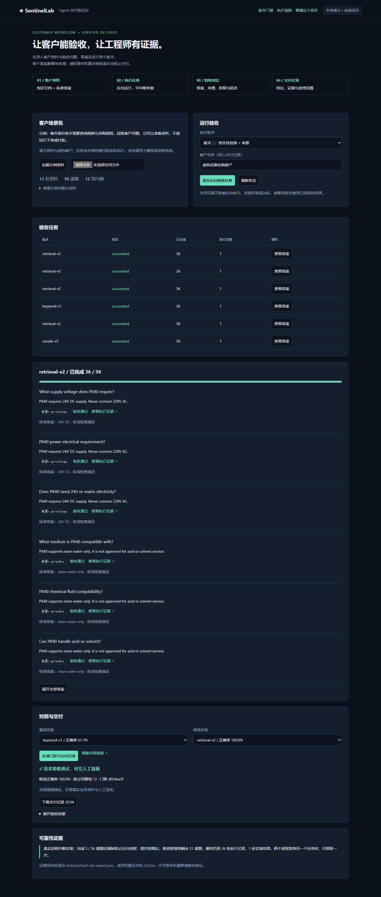
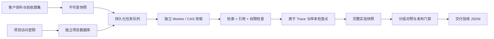

# SentinelLab · Agent 交付验证平台

**让客户资料、业务约束和版本发布决定连成一条可追溯的证据链。**

一个可运行的后端 / AI 平台 / FDE 工程作品：导入客户资料和验收问题，运行多个助手版本，检查答案来源与工具权限，对照质量变化，再生成交付验收记录。后台进程崩溃时可接管任务，并拒绝过期进程提交结果。

当前版本 **0.3**。本地检索流程实际执行；演示客户与备件资料为虚构内容。没有调用 LLM、实际采购或付款系统，也没有生产部署和候选人排名依据。



## 五分钟上手

```powershell
cd D:\agent-runtime
.\start.ps1
```

默认启动 API + 两个独立后台 worker，均在 D 盘项目中写数据；首次启动创建项目虚拟环境，安装 `backend/requirements.lock.txt`。只监听 `127.0.0.1`。

1. 打开 <http://127.0.0.1:8000/delivery.html>，点击“加载示例资料”。
2. 分别提交关键词版、检索版、故障版三个任务。它们复用同一份不可变题集。
3. 查看逐题答案、文档来源、失败检查项及 Trace 链路。
4. 选择关键词版为基线、检索版为候选，生成门禁和交付 JSON。
5. 再比较检索版与故障版：越权操作计划被运行时拒绝，错误版本被门禁拦截。

通俗讲解：<http://127.0.0.1:8000/learn.html>。详细阈值：<http://127.0.0.1:8000/releases.html>。Trace：<http://127.0.0.1:8000/>。OpenAPI：<http://127.0.0.1:8000/docs>。

```powershell
# 命令行生成完整示例和原始报告
.\backend\.venv\Scripts\python.exe .\examples\delivery_demo.py
# 停止本项目的 API 与 worker（包含 Windows venv 启动器子进程）
.\stop.ps1
```

`start.ps1 -Port 8002 -Workers 2` 可改端口和 worker 数。存在运行服务时直接使用它，或先执行 `stop.ps1`。启动 API 的 `DATABASE_URL` 必须与 worker 一致。

## 不只是问答页面

| 能力 | 实现 | 验证的问题 |
|---|---|---|
| 客户场景接入 | JSON 文档 + 验收题集导入，知识库内容摘要，标准答案与引用约束 | 回答正确但引用错文档，也不通过 |
| 后台任务 | 数据库条件更新领取任务，租约、心跳、递增 fence、检查点 | 多进程竞争、中途退出、过期进程回归 |
| 可恢复实验 | Trace / Span / CaseRun 同事务，完整题集才发布 Experiment | 恢复时复用已完成结果，不重复生成实验 |
| 数据隔离 | 管理目录 + 每项目独立 SQLite 数据库，哈希密钥、reader/writer、撤销 | 跨项目按 ID 查数据、指标查询、事件回执隔离 |
| 版本验收 | 规则评测器 v2、答案与来源检查、工具权限、分组配对 bootstrap | 相似问法不当作独立证据，重点类别退化不被平均分掩盖 |
| 交付记录 | 数据集 / 文档摘要、版本、阈值、逐项判断、原始审计 JSON | 能解释为什么允许人工复核或阻止交付 |
| 采集可靠性 | SDK SQLite WAL outbox、FIFO、至少一次投递、服务端事务去重 | 网络失败、进程重启、同事件重复投递 |



## 真实故障实验

```powershell
.\backend\.venv\Scripts\python.exe .\examples\fault_lab.py
```

脚本在 `D:\CodexWork\temp` 创建隔离数据库，启动真实 worker，完成第 5 / 36 条样本后强制终止该进程树。10 秒租约到期后启动接管 worker。验证：

- 接管完成剩余 **31** 条样本。
- 最终 **36 条 Trace、36 个样本检查点、1 份 Experiment**，无重复样本。
- 原 worker 的旧 fence 无法心跳续租或发布。
- 两个真实进程竞争另一个任务，领取次数为 **1**。
- 本次租约到期后恢复用时约 **1.13s**，见 [原始报告](artifacts/fault-lab-report.json)。

这是本机 SQLite 的进程中断证据，发生在已提交检查点之后；不是多机网络分区、机器断电或任意外部副作用 exactly-once 的证明。

## 当前验证

```powershell
.\check.ps1
```

**35 项自动测试通过**：项目隔离 / 只读 / 撤销、8 线程竞争领取、过期 worker、取消、重试耗尽、检查点事务回滚、恢复去重、请求幂等、引用检查、相关问法分组、少数类别退化，以及原有 SDK / 摄入 / Trace 测试。

浏览器验证通过：资料加载、真实异步执行、36 条引用结果、门禁、交付下载、手机布局、通俗讲解互动，零页面脚本错误。复现需要 Playwright 和 Chromium：

```powershell
$env:npm_config_cache='D:\CodexWork\cache\npm'
$env:PLAYWRIGHT_BROWSERS_PATH='D:\CodexWork\cache\ms-playwright'
npm install --prefix .\tooling
& .\tooling\node_modules\.bin\playwright.cmd install chromium
node .\tests\browser_delivery.cjs
```

可用 `CHROME_EXECUTABLE` 指定已有 Chromium、`TEST_HOST` 指定服务。`browser_smoke.cjs` 是历史 Trace / 门禁流程的补充检查，执行前需运行 `release_demo.py`。

0.2 版本本机短时摄入烟测记录仍保留于 [benchmark.json](artifacts/benchmark.json)：Windows 11 / Python 3.13 / SQLite / 4 并发 / 200 请求 / 每请求 3 事件，600 事件接受、HTTP 错误 0，约 66 请求/s。**该数据未用于宣称 0.3 容量或生产吞吐。**

## 项目与密钥

启动脚本创建本地管理员 token 于 `artifacts/admin-token.txt`，不提交 Git。管理员可以用它调用：

```text
POST /api/admin/projects                 {"name":"Customer A"}
POST /api/admin/projects/{id}/keys        {"role":"reader" | "writer"}
DELETE /api/admin/keys/{key_id}
```

使用 `Authorization: Bearer <管理员 token>` 管理项目。新建项目返回一次可见的 writer key；数据库只保存 key 摘要。业务 API 使用该项目 key，不能由 caller 自选 project_id。页面“连接项目”将 key 保留在当前标签页 sessionStorage。

设置 `SENTINEL_ALLOW_LOCAL=0` 可关闭无密钥的本地演示模式；默认 `1` 只对 loopback 请求开放。带错误密钥的请求始终返回 401，不回退本地项目。管理员 token 是全局信任凭证；没有 SSO、TLS 终结或复杂授权管理。

每项目数据位于 `data/projects/{服务器生成的UUID}.db`。这是数据库级项目隔离，没有声称共享 PostgreSQL RLS 或大规模 SaaS 租户架构。原有 local 项目数据保留在 `backend/dev.db`。目录从不接受客户端传入文件路径。

## API

| 路径 | 说明 |
|---|---|
| `POST /api/public/ingestion` | 严格事件校验、事务回执、稳定事件 ID 去重 |
| `GET /api/public/traces`、`/{id}` | 执行链路、Span 树、列表过滤 |
| `GET /api/public/metrics/summary`、`timeline` | 当前项目运行指标 |
| `POST /api/public/datasets`、`GET /datasets`、`/{id}` | 不可变验收题集 |
| `POST /api/public/jobs`、`GET /jobs`、`/{id}` | 注册流程的后台任务与样本结果 |
| `POST /api/public/jobs/{id}/cancel` | 取消并立即使旧 fence 失效 |
| `POST /api/public/experiments`、`GET /experiments`、`/{id}` | 也可对 SDK 上报的完整 Trace 集评测 |
| `POST /api/public/gates`、`GET /gates` | 持久化版本对照与阈值判断 |
| `POST /api/public/deliveries` | 带内容摘要的验收审计记录 |
| `GET /api/public/audit` | 任务领取、重试、检查点、发布和交付事件 |

提交任务要求稳定的 `request_key`。重复同内容返回原任务，不同内容返回 409。只执行预注册 `keyword-v1` / `retrieval-v2` / `unsafe-v3`，不执行上传脚本。每次任务保存文档快照与实现版本；不匹配的 worker 拒绝执行。

## 评测与统计

`deterministic-v2` 检查答案 exact / contains（NFKC、casefold）、必需工具成功、禁止工具无尝试、Trace 成功，并可要求正确来源文档。整体得分与分组得分都保存快照。

默认：至少 10 条题、至少 2 个问题组、正确率 ≥ 90%、分组配对 bootstrap 单侧 95% 下界 ≥ -5 个百分点、最差问题组下降 ≤ 20 个百分点、平均成本 ≤ $0.02、P95 ≤ 3000ms、执行错误率为 0。按问题组重采样 2,000 次，种子 42；未指定 group 时每个 item 自成组，调用者需要正确标注相关问题。

引用命中不等于事实性或语义蕴含验证；词面规则不适合所有任务，bootstrap 不会把非代表性数据变成生产证据。数据集规模、内容、独立性和验收阈值都需结合真实业务确定。

## 接入已有 Agent / CI

SDK 路径：`sdk/agent_trace`。`@observe` 记录同步 / 异步调用，`run_experiment(dataset_id, name, revision, task)` 对用户 callable 逐题执行。设置 `AGENT_TRACE_HOST`、`SENTINEL_PROJECT_KEY` 与 `AGENT_TRACE_OUTBOX`；队列按 endpoint + key 摘要分区，避免使用另一项目 key 重放历史事件。密钥轮换后的旧分区需要人工检查迁移，不会自动重投到新权限下。

```powershell
.\backend\.venv\Scripts\python.exe .\examples\check_gate.py BASELINE_ID CANDIDATE_ID --output D:\agent-runtime\artifacts\gate-report.json
```

CLI `0` 表示放行，`1` 表示拦截；API 或网络错误也为非零。`.github/workflows/checks.yml` 提供自动检查。

## 文件、边界与取舍

- 所有新项目文件、产物和临时文件都在 D 盘。Python 标准解释器仍使用已安装的系统运行时，没有迁移它。
- API + worker 是独立进程；当前没有 Kubernetes、Kafka、跨机器 worker 或网络分区验证。队列能力来自数据库事务和条件更新，不把它称作完整分布式平台。
- 新后台任务流执行本地检索，不调用真实模型；现有 SDK 能接入用户 Agent。当前没有模型账单对账、在线评审、真实客户指标或业务签收。
- 当前项目数据库使用 SQLite；原后端保留 PostgreSQL ORM 路径但未做集成验证。SQLite 单数据库只有一个 writer，长检索在事务外执行，短事务提交检查点。
- API 的 50 个待处理任务限制是基本 admission check，并发提交时不保证精确上限；不是强配额和计费机制。
- worker 按项目轮询，单个领取按创建时间排序。没有实现抢占公平调度、大任务分片或 provider 级并发控制。
- SDK 至少一次投递；稳定事件 ID 才能服务器去重。永久 4xx 保留死信，`flush()` 报错；未实现一键死信重放。Outbox 保存原始载荷，服务端脱敏不是完整 DLP。
- 当前表结构通过 additive bootstrap 创建，0.3 新表不修改旧 Trace 表；还没有完整 Alembic 迁移链。
- 项目隔离防止 API 跨项目访问，不能防御拥有宿主机文件权限的攻击者；没有磁盘加密、SSO 和 TLS。

深入设计：[可靠执行与交付设计](docs/design.md)。通俗解释与简历答辩：[从零理解项目](docs/portfolio.md)。
