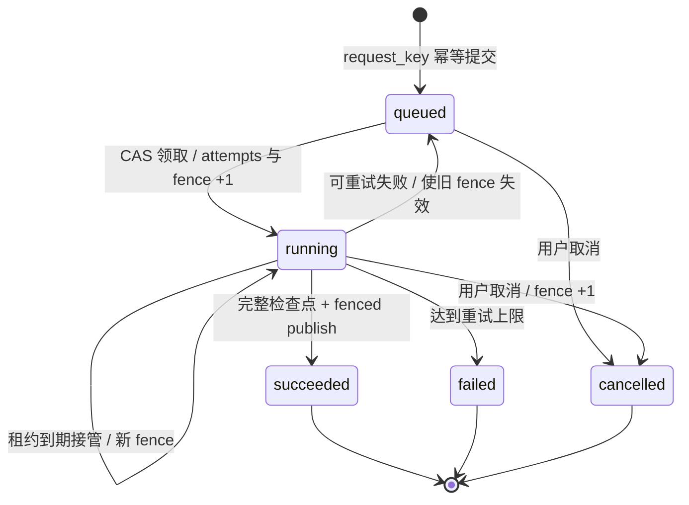

# 0.3 核心设计：可靠执行与可追溯交付

本文记录 0.3 基础设计。0.4 增量见 [真实模型与人审](real-model.md)：已补长 RPC 心跳、模型接入、证据选择、专用评审权限和技术验收。下面没有这些能力的描述仅适用于旧版本。

## 设计目标与范围

在单机、本地数据库条件下，让任务可恢复、过期执行者不能发布、项目不能通过 API 互相访问、实验判断能复查。当前不覆盖多主数据库、跨机时钟漂移、机器断电、网络分区或真实订单副作用。

产品定位是 Agent 交付验证平台。虚构备件报价场景用于构造来源、规格和审批约束，并非行业技术认证或真实客户成功案例。

## 状态机



提交请求对 `request_key` 建唯一约束。摘要包括数据集 ID / 内容、revision、文档快照和 pipeline version。相同请求返回已有 Job；同 key 不同摘要返回 409。没有在 HTTP 请求生命周期内直接执行任务。

## 领取、续租与 fence

`claim()` 先读候选 ID，再用数据库 UPDATE 的 WHERE 原子判断：状态仍为 queued，或 running 且租约已到期；同时 attempts 尚未耗尽。只有 UPDATE 影响一行才成功。所有 worker 都执行相同条件，无需依赖进程内互斥锁。

成功领取会递增 attempts 与 fence，写 owner 与 lease_until_ms。之后 heartbeat、checkpoint、publish 都要求：

```text
job.id == lease.job_id
state == running
owner == lease.owner
fence == lease.fence
lease_until_ms > now
```

租约时间使用本机 wall clock。未验证跨机时钟差；SQLite worker 不能通过网络共享 WAL 文件作为多主系统。当前默认租约 10 秒，每个样本执行前续租。注册检索流程在事务外计算，样本超时会使检查点失败并回滚；没有为长期外部 RPC 实现持续后台心跳。

## 样本事务与发布事务

检索在事务外执行，减少 SQLite 单 writer 的占用。checkpoint 中先验证当前授权，再在一个事务写：

```text
Trace + Span(s) + CaseRun(job_id,item_id) + Job.completed + AuditEvent
```

`CaseRun(job_id,item_id)` 唯一约束与由 job/item 派生的确定性 Trace ID 防止重复。提交前再验证租约未超时，失败则全部回滚。恢复时读取已完成 CaseRun 并跳过，不重新消费完成样本。

`publish()` 验证全部 item_id 与题集恰好一致，保存 Experiment 快照，再使用当前 fence 和未过期租约更新 Job 为 succeeded。更新失败会把新 Experiment 一起回滚，防止旧 worker 生成孤立发布结果。

SQLite 的单 writer 使这些短事务串行竞争；不是无锁算法。相关官方说明：[SQLite isolation](https://www.sqlite.org/isolation.html)、[WAL](https://www.sqlite.org/wal.html)。若后续采用 PostgreSQL，可比较条件更新与 `SKIP LOCKED` 的争用代价；当前未使用后者，也未验证 PostgreSQL。参考：[PostgreSQL SELECT documentation](https://www.postgresql.org/docs/current/sql-select.html)。

## 项目隔离与授权

全局数据库存 Project 与访问密钥摘要。API 从 Bearer key 查到服务器控制的 project_id，选择该项目的数据库连接。客户端提交 dataset_id、trace_id 或 job_id 时，它们只在当前数据库查询，不会为了查 ID 转去其他项目。

每项目 SQLite 数据库复用同一 ORM schema。key 撤销在下一次请求生效；reader 只能 GET / HEAD / OPTIONS，writer 可写。错误 key 返回 401，即使从 loopback 来也不回退本地项目。

部署信任边界仍然是宿主机：文件管理员可直接读 SQLite，管理员 token 可管理所有项目。没有 SSO、TLS、磁盘加密和细粒度业务角色。浏览器把 key 放在 sessionStorage；这仍需要避免 XSS，而不是声称存储方式免疫前端攻击。

SDK outbox 的分区由 endpoint + key 摘要决定。这样不会把 A 项目遗留事件用 B 项目 key 发出。轮换 key 后旧分区仍保留，不能自动把旧权限下的事件挪到新权限。

## 注册执行与运行时边界

任务只接受预注册 revision，不执行用户上传 Python。上传的是文档和题集，服务端按 Pydantic 限制尺寸、文档数量及字段。

`keyword-v1` 使用简单关键词首个匹配；`retrieval-v2` 使用 BM25 检索并返回来源；`unsafe-v3` 产生故障操作计划。计划中的付款和下单动作被运行时拒绝，并记录 error Span、executed=false。没有实际调用交易系统。

安全检查不是仅靠 prompt；动作必须通过注册流程的允许边界。当前实现是本地流程内的硬编码规则，没有通用可扩展权限策略引擎或真实工具沙箱。

## 分组评测

样本包含 group 和 expected_citation。答案、引用、工具约束和 Trace 状态一起判分，实验保留结果快照。

对照要求同一 dataset_id、同一 evaluator version、独立执行 Trace 集。问题改写按 group 聚合，bootstrap 每次抽取 group，再带入该组全部配对差值。这减少将重复问法视为独立样本的倾向。

门禁另加最差组退化上限，防止大量简单题掩盖少数关键题失败。group 由数据作者提供，不会自动识别相关性；分组、题集代表性和样本数仍需人工判断。置信下界不是业务安全或模型泛化保证。

## 审计与交付

Job 快照保留 corpus digest / pipeline version。Experiment 保留当时逐题输出；GateReport 保留阈值、检查结果、配对样本与统计方法版本。Delivery 记录客户标签、流程、数据集 / 文档摘要和门禁结论。

内容摘要用于检查记录内容是否一致，不是数字签名或不可篡改审计日志。数据库管理员仍可修改数据。门禁通过对应“ready-for-human-review”，不是客户签收，也不会自动部署或授权采购。

## 故障矩阵与当前证据

| 故障 | 预期 | 证据 |
|---|---|---|
| 8 线程抢同一任务 | 一个当前领取者 | 自动测试 |
| 2 独立进程抢同一任务 | attempts=1 | 真实故障脚本 |
| 5 / 36 检查点后进程被终止 | 接管剩余 31、无重复 Trace / Experiment | fault-lab-report.json |
| 旧 worker 被新 worker 接管 | 心跳、检查点和发布被拒绝 | 自动测试 + 真实脚本 |
| 写 Trace 后、检查点前异常 | Trace 与检查点一起回滚 | 自动测试 |
| 任务取消 | 当前 fence 失效，无法继续发布 | 自动测试 |
| 反复崩溃达到上限 | failed 终态 | 自动测试 |
| A 项目读取 B ID | 404 / 空列表，指标隔离 | 自动测试 |
| reader 写入 / key 撤销 | 403 / 401 | 自动测试 |
| 多数题高分，关键组全退化 | 门禁阻断 | 自动测试 |
| 答案正确、引用错误 | 样本失败 | 自动测试 |

未验证的故障包括磁盘满、磁盘损坏、宿主机断电、长期高负载、多机共享、数据库 failover、外部模型计费重复和业务订单确认。基本待处理任务上限是 admission check，存在并发提交超出精确上限的可能；没有声称强配额。

## 后续最有价值的改进

应先接入真实且获准使用的客户语料和 Agent，建立分层题集、人工验收与重复运行统计，再增加真实模型适配与账单对账。基础设施方向优先是 PostgreSQL 集成验证、迁移链、外部 RPC 心跳 / 取消、死信管理、项目公平调度和更长负载报告。规模证据出现后才决定是否引入专门队列或分析存储。
